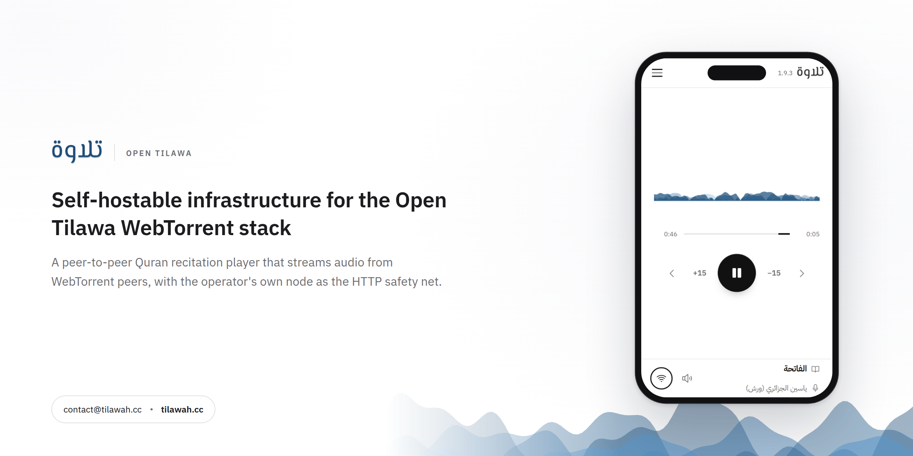

# open-tilawa



Self-hostable infrastructure for the **Open Tilawa WebTorrent stack**: a
peer-to-peer Quran recitation player that streams audio from WebTorrent peers,
with the operator's own node as the HTTP safety net.

Playback, cold starts and the no-peer path are documented in
**[docs/STREAMING.md](docs/STREAMING.md)**.

## High-level architecture

```
Browser (React/Vite SPA)
   │  WebTorrent (WebRTC + WebSocket trackers)
   │  HTTP range requests to our own web seed (/media/<folder>/<file>)
   ▼
Edge (nginx)  ──►  Web (SPA + /torrents/*.torrent + /media/*)
   │
   ├──► Tracker (bittorrent-tracker, WS+HTTP)  ◄── seeders + browsers
   │
   └──► (coturn, host network)  ◄── WebRTC relay
Seeder (node WebTorrent)  ──►  downloads torrents, saves .torrent files to shared volume
```

### Services (docker-compose.yml)

| Service | Image | Role | Port |
|---|---|---|---|
| `edge` | nginx:alpine | Reverse proxy: routes `/` to web, `/stats`+WS to tracker | 127.0.0.1:8084 |
| `web` | node:20 build → nginx | Vite SPA + serves `/torrents/*.torrent` from shared volume | 80 (internal) |
| `tracker` | bittorrent-tracker | WebSocket + HTTP tracker for WebTorrent peers | 127.0.0.1:8083 |
| `seeder` | node:22 | Seeds all reciter torrents; writes `.torrent` files to `seed_torrents` volume | 6881 |
| `turn` (separate compose) | coturn | STUN/TURN relay for WebRTC (host network) | 3478, 5349, 49160–49200 |

Volumes: `seed_downloads` (seeder data), `seed_torrents` (shared with web for `.torrent` serving).

### Data flow

1. **Seeder** loads every `.torrent` in `/data/torrents`, downloads the release into `/data/downloads`, and keeps seeding. The `.torrent` files are shared with the web container (`/torrents/`), the payload is mounted at `/media/`.
2. **Browser** loads the SPA and asks the admin catalogue for the published reciters (`GET /api/public/reciters`). There is no reciter list in the bundle; the last good payload is cached in `localStorage`.
3. **Selecting a reciter** starts `use-torrent.ts`:
   - Fetches `/torrents/{infohash}.torrent` (metadata over HTTP, no peers needed).
   - On 200: `client.add(torrentBlob, { announce: wsTrackers, deselect: true })`.
   - On 404: falls back to `client.add(magnet)` (requires WebRTC peers).
4. **Playback**: the app registers one service worker (`/sw.js`, PWA + WebTorrent merged), calls `client.createServer()`, and points `<audio>` at `file.streamURL` — a **same-origin** `/webtorrent/<infohash>/<path>` URL. The worker answers range requests from torrent pieces, so playback starts on the first pieces and seeking works. `<audio>` never points at a remote file.
5. **No peers**: after 8 s with zero peers the client calls `torrent.addWebSeed("<origin>/media/")`. The HTTP channel then stays open for the life of the torrent — mobile P2P drops and recovers constantly, and detaching the fallback at the first peer would turn every handover into a stall. Pieces from it are verified, stored, seeded to other peers, and peers are used in parallel whenever they exist. The audio element's `src` does not change.
6. **Selection**: only the current surah is selected (`deselect: true` + `file.select()`), so the rest of a 114-file torrent does not compete for bandwidth.
7. **TURN**: coturn relays WebRTC when direct P2P fails (symmetric NAT). External IP is resolved from the DDNS hostname `turn.tilawah.cc`.

### Key constraints (browser WebTorrent)

- **WebSocket trackers only** (`wss://`/`ws://`). HTTP/UDP trackers are silently ineffective in a browser.
- **Metadata without peers**: host `.torrent` files over HTTP (`client.add(url)`) — preferred over magnet fallback.
- **Web seeds** are `fetch()` calls: the host must allow CORS, and the URL must end in `<torrent folder>/<file>`. Our own `/media/` is same-origin and has that layout, which is why it is the only fallback.
- **Incremental vs full-file**: stream with `file.streamURL` (service worker, range requests). `file.blob()`/`getBlobURL()` are gone in v3 and would download the whole file first.

### Service worker (PWA + WebTorrent)

One worker owns scope `/` and does both jobs: Workbox precaches the app shell
and serves navigations, while a vendored copy of WebTorrent's `sw.min.js`
answers `/webtorrent/*` range requests. It is built with
`vite-plugin-pwa`'s `injectManifest` strategy from `apps/web/src/sw.js`.

See [apps/web/README.md](apps/web/README.md) for the merge contract, the nginx
`/sw.js` no-cache rules, and the WebTorrent version-bump procedure.

### Environment (.env)

| Key | Purpose |
|---|---|
| `EDGE_PORT` | Edge nginx port (default 8084) |
| `TRACKER_PORT` | Tracker port (default 8083) |
| `MAGNETS_URL` | Magnet list for the legacy `seed.mjs` node type (`seed-all.mjs` reads `/data/torrents` instead) |
| `ITQAN_API_KEY` | Itqan CMS API key for `import-itqan.mjs` (seeder only; never shipped to the web app) |
| `TURN_REALM` | Coturn realm (turn.tilawah.cc) |
| `TURN_USERNAME` / `TURN_PASSWORD` | Coturn credentials |
| `TURN_EXTERNAL_IP` | DDNS hostname (turn.tilawah.cc) — resolved at coturn startup |

### DDNS

`update-turn-dns.sh` runs every 5 min (cron), updates the Cloudflare A record for `turn.tilawah.cc`, and restarts coturn only when the IP changed.

### Deployment

```bash
cp .env.example .env   # fill in TURN creds
docker compose up -d --build
docker compose -f docker-compose.turn.yml up -d
```

Endpoints (local): Edge `http://127.0.0.1:8084/`, Tracker stats `http://127.0.0.1:8084/stats`, Health `http://127.0.0.1:8084/health`.

Versioning, tags and the order to deploy in: [docs/RELEASING.md](docs/RELEASING.md).

### Related repos

- `adelpro/open-quran` — frontend/app repo (external for now)
- `adelpro/open-quran-tracker` — original tracker + seeder (kept as-is)

## Current state (October 2026)

- **Reciter roster** comes from the admin catalogue only; publication is a flag
  on the row, so curation needs no deploy. Ten reciters are published.
- **Riwaya** is data (`Hafs`, `Warsh`, `Qalon`, `unknown`), never a default.
- **Fallback** is a BEP19 web seed on our own origin (`/media/`), added after 8 s
  with zero peers. It seeds back to peers and never replaces the `<audio>` source.
- **Importing a source** is a one-off seeder job (`import-itqan.mjs`) that
  downloads, verifies and seeds the release; the browser never talks to the
  source host.
- Historical phases 1–5 (2019–2025 experiments with `streamTo()`, offline
  downloads, `ws=` mirrors) are superseded by the flow in
  [docs/STREAMING.md](docs/STREAMING.md).

## Deploying New Nodes

### Seeder Node (Docker)

Run on any Ubuntu/Debian server:

```bash
curl -sSL https://raw.githubusercontent.com/adelpro/open-tilawa/main/deploy-node.sh | bash -s -- --type seeder --port 8085 --admin-user admin --admin-pass YOUR_PASSWORD
```

Add a disk cap (recommended on a shared host) and follow image releases:

```bash
curl -sSL https://raw.githubusercontent.com/adelpro/open-tilawa/main/deploy-node.sh \
  | bash -s -- --type seeder --disk 500 --upload-kbps 20000 --watchtower
```

Without `--disk` the node reports its free space and accepts anything that fits;
with it, the node refuses a magnet whose length would cross the cap. The script
refuses a cap larger than the disk it is installing onto. The generated compose
publishes the admin port and the peer port `6881` (TCP+UDP) and keeps
`/data/torrents` and `/data/downloads` on separate host volumes, so a recreate or
a Watchtower update never discards downloaded audio.

Then add to console:
1. Go to https://console.tilawah.cc
2. Navigate to **Seeders** → **Add Seeder**
3. Name: server hostname
4. URL: `http://<server-ip>:8085`
5. Leave *Add the catalogue to this node* ticked to queue every reciter the node
   is missing as soon as it is registered

The node's version, build SHA, disk, quota and headroom appear on the seeders
screen after the first probe. **Unlink** removes the node from the console only;
the node keeps seeding.

### TURN Server (Native)

```bash
curl -sSL https://raw.githubusercontent.com/adelpro/open-tilawa/main/deploy-node.sh | bash -s -- --type turn --turn-realm turn.tilawah.cc --turn-user opentilawa --turn-pass YOUR_PASSWORD
```

Then add to console:
1. Go to https://console.tilawah.cc
2. Navigate to **TURN Servers** → **Add TURN Server**
3. Name: `hostname-turn`
4. URL: `turn:<server-ip>:3478`

### Environment Variables

| Variable | Default | Description |
|---|---|---|
| TYPE | seeder | Node type: seeder or turn |
| PORT | 8085 | Seeder admin port |
| ADMIN_USER | admin | Seeder admin username |
| ADMIN_PASS | change-me-in-prod | Seeder admin password |
| DISK_GB (`--disk`) | unlimited | Cap on what the node holds, in gigabytes |
| UPLOAD_KBPS / DOWNLOAD_KBPS | 0 (unlimited) | Bandwidth caps for the seeding client |
| ADMIN_UI | 1 | `0` keeps the admin API and hides the browsable page |
| PEER_PORT (`--peer-port`) | 6881 | Inbound peer port, published TCP+UDP |
| WATCHTOWER (`--watchtower`) | 0 | `1` adds a label-scoped Watchtower to follow image releases |
| TURN_REALM | turn.tilawah.cc | TURN realm |
| TURN_USER | opentilawa | TURN username |
| TURN_PASS | (auto-generated) | TURN password |
