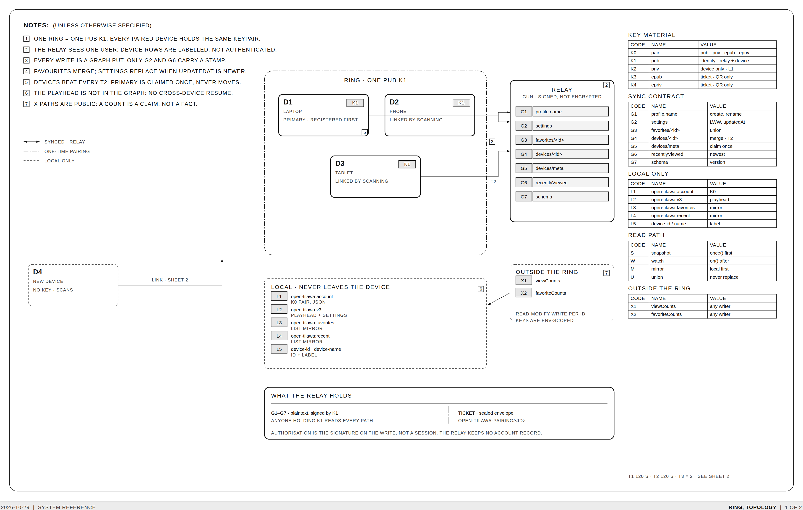
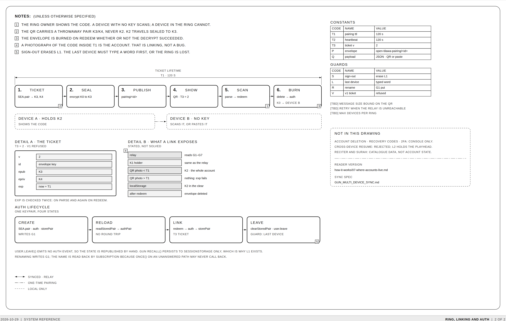

# Authentication and the account ring

Two identities exist in this repository and they never meet:

- **The ring** — the listener's account in `apps/web`. It has no server, no
  username, no password and no email. This document is about the ring.
- **The console account** — the operator's login in `apps/admin`: email, password,
  JWT, 2FA, setup token, trusted devices. It is a normal server-side account with
  an audit trail, documented in the console's Help screen and `ADMIN-NODES.md`.

*Sheet 1. Every code in the drawing (`K`, `G`, `L`, `X`, `T`) is a table entry;
`[TBD]` means the source does not state a value. The drawing is
[`auth-and-rings/sheet.html`](auth-and-rings/sheet.html) — regenerate the PNGs with
`node render.mjs` in that folder.*

## 1. A ring is one keypair

An account is a Gun/SEA keypair generated **on the device**. `pub` is the
identity; `priv` is the only thing that can sign as it. There is no account
record on any server: the relay stores the user's graph, not a user row.

| Code | Field | Lives |
|---|---|---|
| K0 | the pair — `pub`, `priv`, `epub`, `epriv` | `localStorage`, key `open-tilawa:account` |
| K1 | `pub` | in the graph, in every write's signature |
| K2 | `priv` | the device, and inside a sealed ticket while linking |
| K3/K4 | `epub`/`epriv` | the pairing ticket and the QR, for ≤ T1 |

A device that holds K0 **is** the account. That is why "linking a device" is
copying a key rather than authorising a session — and why the sign-out guard in
§5 exists.

Code: `apps/web/src/hooks/use-gun.ts` (`createAccount`), `gun/account-store.ts`.

## 2. Creating an account

1. `SEA.pair()` generates K0 on the device.
2. `user.auth(pair)` signs in to the relay as that pub.
3. K0 is written to `open-tilawa:account` (L1).
4. `profile.name` (G1) is written, so other devices can show a ring name rather
   than a pub.

No email, no recovery phrase, no password reset. Lose every device and the ring
is gone; there is nothing to recover it from.

The name is read back by **subscription**, not a one-shot read: `.once()` on a
path the relay has not answered yet may never call back, which is how a fresh
ring used to show a placeholder name indefinitely (`gun/auth.ts`,
`watchRingName`).

## 3. Staying signed in on the same device

Gun's own `recall()` persists to `sessionStorage` only, so closing the browser
would end the account. `startAuthBridge()` therefore reads L1 at boot, calls
`authPair()` with the stored K0, and republishes auth state. If the relay
rejects the pair, L1 is erased rather than retried forever (`gun/auth.ts`).

## 4. Linking a second device

*Sheet 2. The QR carries K3/K4, never K2 directly.*

Six steps, all in `gun/pairing.ts`:

1. **Ticket** — the device that holds K0 generates a throwaway pair K3/K4.
2. **Seal** — K0 is encrypted with `SEA.encrypt(accountPair, ephemeral)`.
3. **Publish** — the sealed blob and an expiry go to
   `open-tilawa-pairing/<id>` on the relay.
4. **Show** — the ticket `{v: 2, id, epub, epriv, exp}` is drawn as a QR, or
   copied as text.
5. **Scan** — the new device reads it with the camera or pastes it, checks `exp`,
   fetches the envelope and decrypts it with K3/K4.
6. **Burn** — the envelope is deleted whether or not the decrypt succeeded, then
   `authWithPair()` signs in and writes L1.

Rules that fall out of that design:

- **T1 = 120 s**, checked on the receiving side and again when the envelope is
  read.
- **Version 1 is refused.** `parseTicket` rejects anything that is not `v: 2`;
  v1 was the account pair in the clear.
- **A device in the ring cannot scan.** It already holds K0, so it is shown the
  code; only a device with no key is offered the scanner
  (`components/account/account-sheet.tsx`).
- **A photograph of the code inside T1 is the account.** The ticket narrows the
  exposure to a short, single-use window; it does not remove it.

## 5. Signing out

`clearStoredPair()` erases L1 and `user.leave()` clears the in-memory session.
`leave()` emits no auth event, so the state is republished by hand
(`publishAuthState()`).

Because a ring has no server-side recovery, the last remaining device must type a
confirmation word before it can sign out
(`apps/web/src/components/account/account-sheet.tsx`). With two or more devices,
signing out is one click.

## 6. What syncs

The graph lives inside `gun.user()`. It is **signed, not encrypted** — anyone
holding K1 can read all of it (see §9).

| Code | Path | Written by | Merge rule |
|---|---|---|---|
| G1 | `profile.name` | create, rename | last write |
| G2 | `settings` | any settings change | last-write-wins on `updatedAt` |
| G3 | `favorites/<reciterId>` | favourite toggle | union — never replaces |
| G4 | `devices/<deviceId>` | login, then every T2 = 120 s | merge, per row |
| G5 | `devices/meta` | first device to register | claim once, never overwritten |
| G6 | `recentlyViewed/<reciterId>` | opening a reciter | newest `at` per id |
| G7 | `schema` | login, on version change | version stamp |

Two of those deserve their design note:

- **Settings are last-write-wins on a stamp, not a merge.** `resolveRemoteSettings`
  compares `updatedAt` so a replayed snapshot cannot undo a choice made while the
  snapshot was in flight. Writes are one whole-object `put`, never a
  read-modify-write (`hooks/use-persistence.ts`, `hooks/use-user-sync.ts`).
- **Favourites are a union of three sources** — the relay, this device's mirror,
  and anything favourited while logged out. A replace would delete the
  logged-out ones.

Reads are snapshot-then-subscribe: `once()` first so a screen does not flash
empty, then `.on()` for changes. Device rows are written locally into the atom at
the same moment as the relay write, because waiting for the echo left a fresh
ring showing "0 devices" for a round trip.

## 7. What never leaves the device

| Code | Key or source | Holds |
|---|---|---|
| L1 | `open-tilawa:account` | K0 |
| L2 | `open-tilawa:v3` | playhead per reciter, settings mirror |
| L3 | `open-tilawa:favorites` | favourite ids, for logged-out use |
| L4 | `open-tilawa:recent` | reciter history mirror |
| L5 | `open-tilawa:device-id`, `open-tilawa:device-name` | this device's label |

The **playhead is deliberately absent from the graph**: a second device shows the
same favourites and settings but does not resume where the first stopped.
Cross-device resume was considered and rejected; L2 is the only home for it
(`hooks/use-persistence.ts`).

## 8. What sits outside the ring

Two counters live outside `gun.user()` on purpose: `viewCounts` and
`favoriteCounts`, keyed per reciter and namespaced by environment
(`open-tilawa-<env>-view-counts`). They are anonymous totals — readable by
anyone, writable by anyone. The user's own list is in G3 and never touches these
nodes. Bumps are serialised per id with a read-modify-write chain, because two
bumps in the same millisecond used to tie on Gun's state clock
(`gun/counts.ts`).

A count is therefore a claim, not a fact. It is a popularity hint that never
gates playback.

## 9. What the relay can see

- **The graph, in plaintext.** Gun user spaces are signed, not encrypted. K1 is
  public by construction, so the relay — and anyone who has the pub — can read
  favourites, history, device names and user agents.
- **The envelope, encrypted but short-lived.** `SEA.encrypt` needs
  `crypto.subtle`, so linking only works on https or localhost. The blob is
  useless without K4, and K4 is only in the QR.
- **The device at rest.** L1 is a plain `localStorage` value: anyone with the
  browser profile has the account, exactly as they would have a signed-in session
  cookie. Signing out erases it.

Encrypting the graph itself (SEA.encrypt keyed from `epriv`) is possible but would
mean every device must derive the same key, and a lost device would take the
readable history with it. Not done; not planned.

## 10. Where the code lives

| Concern | File |
|---|---|
| Auth bridge, pair auth, ring name | `apps/web/src/gun/auth.ts` |
| Create, sign out, rename, pair | `apps/web/src/hooks/use-gun.ts` |
| Stored keypair (L1) | `apps/web/src/gun/account-store.ts` |
| Ticket format and validation | `apps/web/src/gun/pairing-ticket.ts` |
| Seal, publish, redeem, burn | `apps/web/src/gun/pairing.ts` |
| Relay → atoms, heartbeats | `apps/web/src/hooks/use-user-sync.ts` |
| Playhead, local mirrors, LWW | `apps/web/src/hooks/use-persistence.ts` |
| Counters | `apps/web/src/gun/counts.ts` |
| Linking and device list UI | `apps/web/src/components/account/` |

## Open questions

These are `[TBD]` on the drawing because neither the code nor the docs decide
them:

- a bound on the QR payload and the parser's input size;
- retry policy when the relay is unreachable during linking;
- a maximum number of devices per ring (nothing enforces one today).
