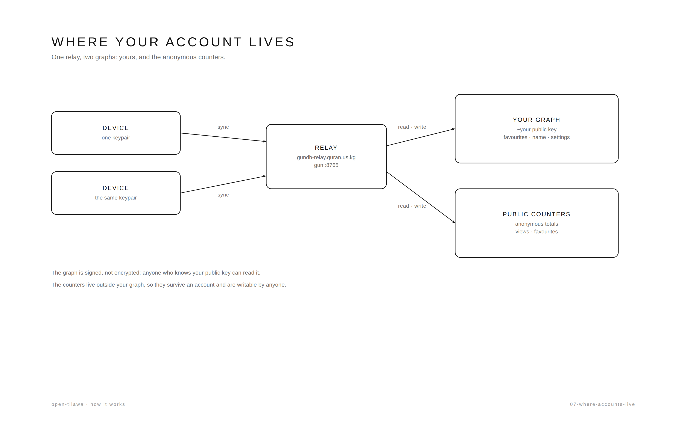
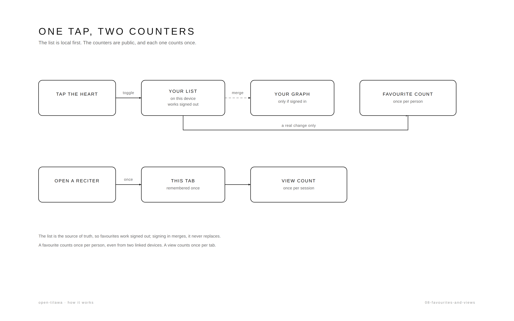

# GunDB Multi-Device Sync + Global Counts



*One relay, two graphs. [The full page](how-it-works/07-where-accounts-live.md).*

> **As built:** the keypair, the pairing ticket and the sync contract are drawn
> and tabulated in [AUTH_AND_RINGS.md](AUTH_AND_RINGS.md). This document is the
> design argument that led there.

## 1) Device Pairing Flow

The core idea: treat the SEA keypair as the identity. Any device authenticated with the same pair is the same user.

> **Implemented as `pairing-ticket.ts` (v2).** The QR never contains the account
> key. It carries a throwaway ECDSA pair plus an id; the real keypair sits on the
> relay encrypted to that throwaway key, for two minutes, and is deleted on first
> successful redeem. See §9 for the as-built details.

### Flow

1. **Create account on Device A**
   - Create a user via `gun.user().create(alias, pass)` or generate a pair directly. 
   - On first creation, persist the pair securely on that device (so it can auto-recall).
   - This device now owns the identity (`~<pub>`).

2. **Initiate pairing from Device A**
   - User goes to "Link another device". 
   - Device A generates a pairing payload containing its SEA pair.
   - Display it as a QR code with a short TTL (e.g 2-5 minutes) and mark it as one-time use.
   - Optionally show a "cancel" to invalidate it.

3. **Connect from Device B**
   - User scans the QR code from Device A.
   - Device B extracts the pair and authenticates with `gun.user().auth(pair)`.
   - On success, Device B is now the same user and begins subscribing to the user graph.

4. **Sync after pairing**
   - Both devices subscribe to `gun.user()` paths (`favorites`, `profile`, `settings`, `progress`, etc).
   - Device B does an initial pull (`.once`) to get existing state, then switches to live updates (`.on`).
   - Both devices continue to sync going forward whenever either changes state.

### Technique Recommendations

- **Start simple**: Direct pair transfer in QR is the easiest and matches the UX you're describing. For a Quran app this is acceptable if paired in a trusted environment.
- **Harden later**: A more secure approach is an ephemeral secret. Device A publishes an encrypted copy of the pair to Gun under a short-lived key, QR contains only the secret + reference to fetch it, and it's deleted after first use.
- **Expiration & one-time use**: Never allow a QR to be reused. Invalidate it on first successful auth or after TTL.
- **Backup awareness**: Make it clear that losing all devices with the pair means the account cannot be recovered. Consider offering a "download pair" as a backup option.
- **Auto-recall**: Use `gun.user().recall()` so returning devices auto-login without rescanning. 


## 2) Data Separation

You must split data by ownership. Mixing them is what causes the double-counting issues you're worried about.

| Data | Location | Who can write | Notes |
| --- | --- | --- | --- |
| **Identity** | `gun.user()` (`~<pub>`) | Only this keypair (cryptographically enforced) | The source of truth for "this user". |
| **Profile/Settings** | `gun.user().get('profile')`, `gun.user().get('settings')` | This user only | Theme, locale, display name, avatar, etc. |
| **Favorites (personal list)** | `gun.user().get('favorites')` | This user only | The list of favorited reciters to sync across devices. This is *"my favorites"*, not the global count. |
| **Favorite metadata (dedup)** | `gun.user().get('favMeta')` | This user only | Per-item record (`{ favorited: boolean, updatedAt: timestamp }`). Critical for preventing double-counting global favorites across devices. |
| **Reading state** | `gun.user().get('reciter')`, `gun.user().get('surah')`, `gun.user().get('progress')` | This user only | "Resume where I left off". Sync across all linked devices. |
| **History** | `gun.user().get('recentlyViewed')`, `gun.user().get('mostViewed')` | This user only | Personal history. Can be merged across devices. |
| **Devices list** | `gun.user().get('devices')` | This user only | Optional but useful to show "linked devices" and revoke them. |
| **View counts** | Global graph (e.g. `open-tilawa-<env>-view-counts`) | Anyone | Anonymous counter. Do not put this under `gun.user()`. |
| **Favorite counts** | Global graph (e.g. `open-tilawa-<env>-favorite-counts`) | Anyone | Anonymous counter of total favorites across all users/devices. Do not put this under `gun.user()`. |


## 3) Sync Strategy Per Data Type

Treat each field differently based on conflict tolerance. Don't try to force one strategy everywhere.

| Data | Technique | Rationale |
| --- | --- | --- |
| **`currentReciter`, `currentSurah`** | **Last-Write-Wins (LWW) with `updatedAt`** | If using two devices simultaneously, the most recent action should win. Store alongside a timestamp and compare on sync. |
| **`progress` (position/timestamp)** | **LWW with `updatedAt`** | Same as above. Prefer the newer timestamp. On conflict, don't blindly overwrite local without checking - if local is newer, push it up. |
| **`favorites` set** | **Union merge** | If Device A favorites X and Device B favorites Y while offline, both must remain favorited. Store as a map of `{ [id]: true }` or Gun sets, and only remove by setting to `null`. Never replace the entire list wholesale. |
| **`favMeta`** | **LWW per item** | Needed for dedup. Track `favorited` state + `updatedAt` per reciter ID so all devices know "has this identity counted this favorite globally?". |
| **`settings`** | **LWW or field-level LWW** | Usually fine with LWW. If you ever have settings that can be edited on both devices, compare by `updatedAt` per setting group. |
| **`recentlyViewed`** | **Timestamped merge + dedupe** | Arrays are the most awkward in Gun. Store as `recentlyViewed/{ [id]: { ts, ... } }`, merge all keys from all devices, sort by `ts` descending, and trim to your desired length (e.g. top 20). Reconstruct on read. |
| **`mostViewed` (personal)** | **Merge with care** | If both devices increment while offline, naive LWW will drop one. Options: store increments with unique keys and sum on read, or track per-device counts and sum. For "most viewed" this is usually acceptable with LWW or approximate merging. |
| **`profile`** | **LWW with `updatedAt`** | Simple fields, LWW is fine. |

### Sync Mechanics

- **Initial load**: On auth/init, use `.once()` to fetch a snapshot of user graph data before listening for changes.
- **Live sync**: Use `.on()` to subscribe to user paths so changes from other linked devices propagate automatically through your Gun relay.
- **Optimistic updates**: Update local state immediately on user action, then write to `gun.user()`. If the relay is slow/offline, Gun will queue and sync when connectivity returns.
- **Cross-device propagation**: Since all devices share the same keypair, writing to `gun.user().get('...')` from any device will be seen by others via the relay/peers.


## 4) Handling Global Counts (Views & Favorites)



*What one tap writes, and how often. [The full page](how-it-works/08-favourites-and-views.md).*

> **As built:** the dedup state is a per-identity set in `localStorage`
> (`utils/favorites-local.ts`), not `favMeta` in the user graph. The graph stores
> the list; the local set remembers what this identity already counted.

This is the most important part. **Global counts must remain anonymous and outside the user graph**. The fix is client-side deduplication by identity.

### Identity for deduplication

- **If logged in (has linked devices)**: Use `gun.user().is.pub` as the identity. Sync `favMeta` from `gun.user()` to all linked devices. This prevents Device A and Device B from double-counting even if both toggle favorites.
- **If anonymous (not logged in)**: Generate a stable anonymous ID in `localStorage` (e.g. `anonId`). Use it for dedup. This prevents the same browser/session from spamming counts and is better than nothing.
- **Prefer logged-in identity when present**: If a user logs in on a device that had anonymous favorites, merge the dedup state from `favMeta` (union) rather than replacing it.

### Favorites Counting Flow

1. **Check local state**: Is this reciter already in "my favorites" (from user graph if logged in, else localStorage)?
2. **Update personal state first**: Optimistically update the personal favorites list and write to `gun.user().get('favorites')` + `gun.user().get('favMeta')` if logged in.
3. **Check dedup**: Look up in dedup store (from `favMeta` if logged in, else from `localStorage`).
   - Adding when not deduped → increment global count, add to dedup
   - Removing when deduped → decrement global count, remove from dedup
   - Adding when already deduped (e.g. synced from another device) → do **not** increment global count
   - Removing when not deduped → do **not** decrement global count
4. **Write to global graph**: Only call the global increment/decrement after passing dedup. Read current count with `.once()`, compute `next = current + delta`, and write back. Clamp to `>= 0` to prevent negative values.
5. **Propagate dedup**: If logged in, writing to `favMeta` syncs to all linked devices automatically, so dedup is consistent across them.

### Views Counting Flow

Views are trickier because "viewing" happens often and isn't as explicit as favoriting.

1. **Session dedup (minimum)**: Use `sessionStorage` to prevent counting the same reciter multiple times on refresh/reload in the same tab/session. This is the same idea as your current plan.
2. **Per-identity dedup (optional but better)**: If logged in, track `viewedMeta` in `gun.user()` with timestamps. You could count "first view" per (user, reciter) ever, or "first view this session/day". Decide based on what you want the number to represent.
3. **Don't block playback**: Never require login to count a view. Keep it frictionless.
4. **Be conservative**: For a Quran app, view counts are mostly vanity. Session dedup is usually sufficient. User-aware dedup is nice to prevent obvious inflation across linked devices, but over-engineering isn't necessary.

### Global Graph Rules

- **Environment scoping**: Use different keys for dev/staging/prod (e.g. `open-tilawa-<env>-view-counts`, `open-tilawa-<env>-favorite-counts`). This prevents cross-environment pollution.
- **Keep schema simple**: Per item, store just the count (e.g. `counts.<reciterId>.count`). Avoid nesting user lists in the global graph.
- **No personal data**: Never write user IDs, IPs, or favorites arrays to global count paths. Only numbers.
- **Defensive writes**: Read-modify-write with `.once()` is fine for simple counters. Accept the small race condition - for vanity counts it's not worth complex distributed locking.
- **Relay is the hub**: Your self-hosted `gun.quran.us.kg` relay will propagate updates between all connected clients. 


## 5) Conflict Resolution Techniques

| Scenario | Technique | Notes |
| --- | --- | --- |
| **Two devices change `progress` at same time** | **Timestamp comparison (LWW)** | Keep `updatedAt` on the object. On receiving remote update, compare with local. If remote is newer, apply it. If local is newer, push local up. |
| **Favorites added on both offline devices** | **Union** | Both additions survive. Never replace the whole set - merge keys. Removing is explicit (`null`). |
| **Same reciter favorited/unfavorited rapidly across devices** | **Per-item LWW with `favMeta.updatedAt`** | The latest action per (identity, reciter) wins for determining "am I currently favorited?" and for dedup decisions. |
| **`recentlyViewed` grows on both devices** | **Merge by timestamp** | Collect all entries, dedupe by reciter/id keeping the newest timestamp, sort descending, cap to limit. |
| **Settings conflict** | **Field-level LWW** | Better than whole-object LWW. Track `updatedAt` per setting or per group so unrelated settings don't clobber each other. |
| **Global count race** | **Accept eventual consistency** | Two clients read same value and increment simultaneously - you'll lose one increment. For view/favorite totals this is acceptable. You can mitigate by reading fresh before write, but not eliminate entirely. |

## 6) Practical Recommendations & Order

Do this incrementally. Don't build everything at once.

| Order | Task | Notes |
| --- | --- | --- |
| **1** | **Port global counts first** | Mirror `open-tarteel`'s `view-rank.ts` and `favorite-rank.ts` to `open-tilawa`. Use env-scoped keys, keep anonymous. Add `sessionStorage` dedup for views. Get this working against `gun.quran.us.kg` first - highest value, lowest risk. |
| **2** | **Add Gun SEA + user auth** | Add `gun/sea`, initialize `gun.user().recall()`. Build simple create/login flow. Don't gate anything behind it yet. |
| **3** | **Sync personal favorites** | When logged in, sync favorites to `gun.user().get('favorites')`. Keep localStorage as fallback for anonymous users. Make it cross-device by subscribing with `.on()`. |
| **4** | **Add device pairing via QR** | Implement direct pair transfer first (simplest). Add TTL + one-time use. Test pairing two browsers/devices. |
| **5** | **Add global count dedup** | Implement `favMeta` in user graph for logged-in users, and stable `anonId` for anonymous users. Only increment/decrement global counts after dedup check. Sync `favMeta` across linked devices. |
| **6** | **Sync reading state** | Add `reciter`, `surah`, `progress` with LWW + `updatedAt`. Add "resume" behavior on load. |
| **7** | **Add history** | Sync `recentlyViewed` with timestamped merge. Add `mostViewed` if desired, being mindful of merge strategy. |

### Key Gotchas to Watch For

- **Pair is unrecoverable**: If the user loses all devices with the SEA pair, there's no password reset. Make this clear in UI.
- **QR security**: Treat the QR as equivalent to giving someone your account. Short TTL, one-time use, and only show when user explicitly requests it.
- **Relay dependency**: Your `gun.quran.us.kg` is the sync hub. If it's down, devices on different networks won't sync until it's back up (though direct WebRTC between them might connect in some cases, don't rely on it).
- **Gun merge behavior**: Gun merges objects, it doesn't deep-merge arrays the way you want. Prefer maps/objects over arrays for synced collections.
- **Double-counting**: This is the biggest issue. The dedup layer (identity-based) is not optional if you care about accurate global counts with multi-device users.
- **Offline conflicts**: Plan for LWW with timestamps now rather than trying to retroactively fix conflicting state later.

**Bottom line:** Keep global counts anonymous and deduplicated by identity. Keep all personal state and the "same account across devices" mechanism under `gun.user()` with SEA. For the QR pairing, start with direct pair transfer + TTL/one-time use - it's the cleanest fit for your described UX.


## 7) Schema Versioning & Migrations

Like `use-persistence.ts` (localStorage v1→v2→v3), the Gun user graph needs schema versioning so older/newer linked devices don't break each other.

### Principles

- **Forward-only migrations**: Never downgrade. Migrate old schemas up to current.
- **Pure migration functions**: Keep them testable (like `migrateV2`, `migrateLegacy`).
- **Idempotent**: Running a migration twice must be safe.
- **Only migrate user-owned data**: Version `gun.user()` graph only. Global count graphs (`*-view-counts`, `*-favorite-counts`) stay simple (just numbers) or get their own minimal versioning if needed.
- **Backward compatible**: Treat missing schema as version `0`.

### Structure

```ts
// src/gun/user-schema.ts
export const CURRENT_USER_SCHEMA_VERSION = 1;

export type UserSchemaMeta = {
  version: number;
  updatedAt: number;
};
```

```ts
// src/gun/user-migrations.ts
export type UserMigration = {
  from: number;
  to: number;
  migrate: (data: UserGraphSnapshot) => UserGraphSnapshot;
};

const migrations: UserMigration[] = [
  // Example:
  // { from: 0, to: 1, migrate: (d) => ({ ...d, favorites: normalizeFavorites(d.favorites) }) },
];

export function migrateUserGraph(snapshot: UserGraphSnapshot, fromVersion: number): UserGraphSnapshot {
  let current = snapshot;
  let version = fromVersion;
  for (const m of migrations) {
    if (m.from === version) {
      current = m.migrate(current);
      version = m.to;
      if (version === CURRENT_USER_SCHEMA_VERSION) break;
    }
  }
  return { ...current, _schemaVersion: version };
}
```

### Storage

Store schema metadata under the user graph (writable only by the owner):

```ts
gun.user().get('schema').put({ version: CURRENT_USER_SCHEMA_VERSION, updatedAt: Date.now() });
```

Or keep it at root level of synced state. Either works as long as it's synced across linked devices.

### When to migrate

| Event | Action |
| --- | --- |
| **After auth/recall** | On successful auth or recall, read `gun.user().get('schema').once()`. If missing or < current, build a snapshot of relevant paths, run migrations, write back migrated data, update schema version. |
| **On receiving remote data** | If a `.on()` update arrives with data that implies an older schema shape (or missing version), migrate before applying to local atoms/state. |
| **On pairing a new device** | The newly paired device pulls from the user graph - run the same migration check on first load. |
| **Cross-device with mixed versions** | A device with newer schema should be able to read older data and migrate it. A device with older schema receiving newer-shaped data should either migrate up if possible or ignore gracefully (log/warn). Forward migration is the priority. |

### Implementation pattern

```ts
// src/gun/ensure-user-schema.ts
import { gun, user } from './index';
import { CURRENT_USER_SCHEMA_VERSION } from './user-schema';
import { migrateUserGraph } from './user-migrations';

export async function ensureUserSchema(): Promise<void> {
  if (!user.is) return;

  const schema = await new Promise<any>((res) => user.get('schema').once(res));
  const fromVersion = schema?.version || 0;

  if (fromVersion >= CURRENT_USER_SCHEMA_VERSION) return;

  // Snapshot relevant user data
  const snapshot = await snapshotUserGraph(user); // collect favorites, progress, etc.
  
  // Migrate
  const migrated = migrateUserGraph(snapshot, fromVersion);
  
  // Write back
  await writeUserGraphSnapshot(user, migrated);
  user.get('schema').put({ version: CURRENT_USER_SCHEMA_VERSION, updatedAt: Date.now() });
}
```

Call `ensureUserSchema()` right after successful `gun.user().auth()` or after `gun.user().recall()` confirms auth.

### Tips

- **Snapshot selectively**: Only snapshot paths you actually migrate. Don't dump the entire graph.
- **Don't block UI**: Run migrations in the background after auth; show data as it loads/migrates.
- **Version per breaking change**: Bump `CURRENT_USER_SCHEMA_VERSION` only on breaking shape changes. Additive fields don't require migration.
- **Global counts**: Skip migration for anonymous global count graphs - they're just numeric counters.
- **Testing**: Mirror `use-persistence.test.ts` style - pure migration functions with fixtures.


## 8) Device Management & Primary Device

With device pairing via the same SEA keypair, there's no built-in "owner" concept in Gun - any device with the pair is fully equal. You need to track devices explicitly if you want a "primary device" or the ability to manage/revoke them.

### Primary Device

- **Definition**: The first device that created the account (generated the keypair / ran `gun.user().create()` or first `auth()` with a newly generated pair). 
- **Not enforced by Gun**: All devices with the same keypair have identical write privileges. You cannot cryptographically prevent a linked device from writing.
- **Optional to track**: For most UX, you don't need to enforce "primary only" - equality is simpler and matches your described flow. Only track a primary if you need special permissions (e.g. require primary approval for certain actions, or show UI differently).

If you do want to track it:

```ts
gun.user().get('devices').get('meta').put({
  primaryPub: user.is.pub, // pub of the creating device/session
  createdAt: Date.now(),
});
```

On first creation, set it. On subsequent devices pairing in, never overwrite `primaryPub` - only set if missing.

### Device Registry

Track linked devices under the user graph so users can see/manage them.

```ts
// Structure
gun.user().get('devices').get(deviceId).put({
  id: deviceId,        // stable id per browser/profile (e.g. uuid in localStorage)
  name: deviceName,    // user-editable or derived (e.g. "Chrome on Linux")
  pub: user.is.pub,    // same for all linked devices
  firstSeen: timestamp,
  lastSeen: timestamp,
  linkedAt: timestamp, // when this device was paired/authenticated
  userAgent: navigator.userAgent,
});
```

- **deviceId**: Generate once per device (e.g. `crypto.randomUUID()`) and store in `localStorage`. This identifies "this device" even if session changes.
- **Update on activity**: Write `lastSeen: Date.now()` periodically (e.g. on app start, visibility change) or on significant actions.
- **Sync across devices**: Since it's under `gun.user()`, all linked devices see each other's device entries.
- **Show in UI**: "Linked devices" list with name, last seen, and option to rename/remove.

### Pairing Flow with Device Tracking

1. **Device A creates account**: Generate `deviceId` for Device A, auth/create user, set `devices.meta.primaryPub = user.is.pub` if not set, write Device A to `devices/<deviceId>`.
2. **Device A initiates pairing**: Show QR with pair + maybe `deviceId` of requester (optional). Mark pairing session as active with TTL/one-time use.
3. **Device B pairs**: Generate `deviceId` for Device B, auth with pair, see that primary exists, write Device B to `devices/<deviceId>` with `linkedAt = Date.now()`, update its `lastSeen`.
4. **Both devices sync**: Device registry propagates to all linked devices.

### Revoking Access

Since all devices share the same keypair, you **cannot truly revoke** a device remotely without changing the keypair. Options:

| Approach | Feasibility | Notes |
| --- | --- | --- |
| **"Sign out" locally** | Easy | Clear pair from `localStorage/sessionStorage` on that device. It won't auto-recall, but if someone has the pair elsewhere, they can still access. This only affects that device. |
| **Key rotation (re-pair)** | Possible but disruptive | Generate a new keypair, migrate all user data from old `~<oldPub>` to new `~<newPub>`, update schema, and re-pair all devices with new pair. Complex and error-prone. Usually overkill. |
| **Device blocklist (soft)** | Possible | Store `blockedDeviceIds` under `gun.user().get('devices').get('blocked')`. Each device checks on load - if its `deviceId` is blocked, it signs out locally. This relies on all devices cooperating and doesn't stop someone who extracts the pair. |
| **Remove from UI only** | Easy | Just remove the entry from the registry - cosmetic, doesn't revoke access. |

**Recommendation**: For this app, implement **local sign-out** + **device list with "remove from list"** (cosmetic) as a start. True revocation isn't really possible with shared-keypair device linking without key rotation. Document this clearly in UI.

### Last Device Protection

If you want to prevent locking yourself out:

- Don't allow removing the "last" device entry without confirmation
- Warn that losing all linked devices means unrecoverable account
- Encourage backing up the pair or keeping at least one trusted device

### Primary Device UX Ideas

- **Badge**: Show "(Primary)" next to the device that matches `devices.meta.primaryPub` or the one that created it
- **No special privileges by default**: Keep all devices equal unless you have a specific need
- **"This device" indicator**: Highlight the current device using its `deviceId`
- **Rename devices**: Let users give friendly names (helps distinguish them)


## 9) As Built (2026-10-27)

What actually shipped in `apps/web`, and the traps found while testing it in a
real browser.

### Relay

- Peer is **`wss://gundb-relay.quran.us.kg/gun`**, not `gun.quran.us.kg` (which
  has no DNS record at all). The tunnel maps it to the gun container on
  `localhost:8765` and needs `originRequest.enableWebsockets: true`.
- A plain `GET /gun` over HTTPS looks like a timeout — the endpoint only speaks
  WebSocket. Test with a `WebSocket`, not `curl`.
- `VITE_GUN_PEERS` (comma separated) overrides the default.

### Files

| Path | Role |
| --- | --- |
| `constants/gun-peers.ts` | peer list, env override |
| `constants/gun-keys.ts` | env-scoped counter keys (`open-tilawa-<env>-*-counts`) |
| `constants/gun-config.ts` | `localStorage: false`, `radisk: false` |
| `gun/index.ts` | the single Gun instance, `user`, `SEA` |
| `gun/counts.ts` | public counters: one subscription per kind, serialised bumps |
| `gun/pairing.ts` | sealed-envelope pairing (v2) |
| `gun/pairing-ticket.ts` | pure encode/parse, no gun import, unit tested |
| `gun/user-schema.ts`, `gun/user-migrations.ts`, `gun/ensure-user-schema.ts` | version stamp + forward migrations |
| `hooks/use-gun.ts` | auth surface (create/login/pair/logout) |
| `hooks/use-user-sync.ts` | account graph → atoms, plus `touchDevice()` |
| `hooks/use-favorites.ts` | local favourites + dedup + `useTrackView()` |
| `hooks/use-global-counts.ts` | counter atoms, safe to call from many components |
| `components/account/*` | sheet, auth form, link device, device list |
| `utils/identity.ts`, `utils/favorites-local.ts` | counting identity + local mirror |

### Identity as built

No username, no password. An account is a keypair generated in the browser
(`SEA.pair()`) and kept in `localStorage` under `open-tilawa:account`; the key is
the identity and the only thing that opens the account. Gun's `recall()` writes
to **sessionStorage only**, so without that stored copy the account died with the
tab and every browser restart needed a fresh pairing scan.

The trade-off is explicit: losing every linked device and the QR means losing the
account. The sheet says so before the first create, and sign-out refuses to run
on the last device without a typed confirmation.

The display name is not part of the keypair — SEA stores only the pair — so it
lives in `profile.name` and every linked device reads it back.

### Pairing (v2) as built

1. `SEA.pair()` makes a throwaway keypair.
2. The account pair is `SEA.encrypt`ed to it.
3. The blob is parked at `open-tilawa-pairing/<uuid>` with `exp = now + 2 min`.
4. The QR holds `{v:2, id, epub, epriv, exp}` — never `priv`.
5. Device B decrypts with only `{epub, epriv}`, then `put(null)` burns the node.

`parseTicket` refuses `v:1` payloads (the old raw-pair format) and anything
expired, so a photographed QR dies after two minutes.

### Counters as built

- Favourites are local-first: `open-tilawa:favorites` in `localStorage` is the
  mirror, `gun.user().favorites` is the sync layer. Logging in **unions** the two
  instead of replacing, so anonymous favourites survive.
- Dedup key is `open-tilawa:counted:<identity>:favorite`, where identity is
  `user:<pub>` or `anon:<uuid>`. Only a real transition moves the public counter.
- Views are counted once per tab session (`open-tilawa:viewed:<id>`).
- Bumps are **serialised per reciter**. Two toggles in the same millisecond used
  to tie on Gun's state clock: the relay kept the newer value while the tab's own
  view stayed stale until reload.

### Traps found in the browser

- **`recall()` only persists to sessionStorage**, and it drops the alias, so the
  sheet showed an 80-character key and the account vanished when the browser
  closed. The keypair is now stored in localStorage and the name in
  `profile.name`.
- **`.once()` on an unseen path may never call back.** The schema write used to
  sit behind that callback, so fresh accounts never got a version stamp. Reads
  are now bounded (1.5 s) and the stamp is written unconditionally.
- **A snapshot must merge, not replace.** The login snapshot can resolve *after*
  `touchDevice()` wrote this device's row; replacing the atom erased it and the
  list said "no devices".
- **Dev PWA caches the bundle.** `devOptions.enabled` means the service worker
  serves stale modules in `npm run dev`; unregister it (or hard-reload) before
  believing a code change.
- **`html5-qrcode` and `qrcode` are dynamic imports.** Static imports added
  ~170 kB to the initial bundle for two screens most users never open.

### Known gaps

- Device rows are never pruned, so a cleared browser leaves a stale row behind.
  A "forget this device" action (and a `lastSeen`-based sweep) is still missing.
- The primary badge marks the first device that registered; it grants no extra
  rights, because Gun cannot enforce that.
- Profile image is modelled (`profile.avatarUrl`) but has no UI.
- Current reciter/surah/progress are synced and stored, but the player does not
  yet restore them on load.
