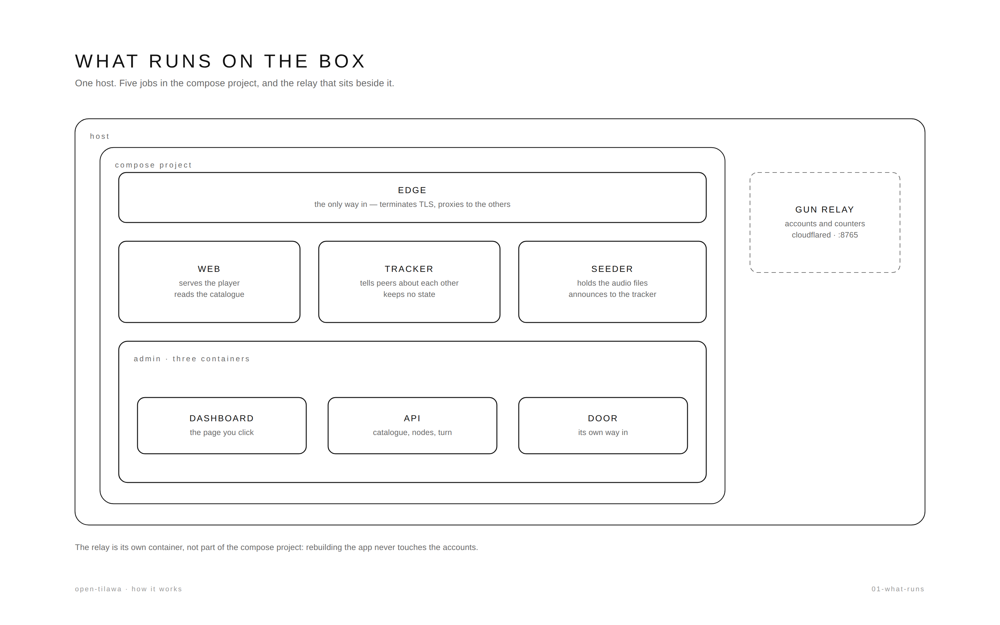
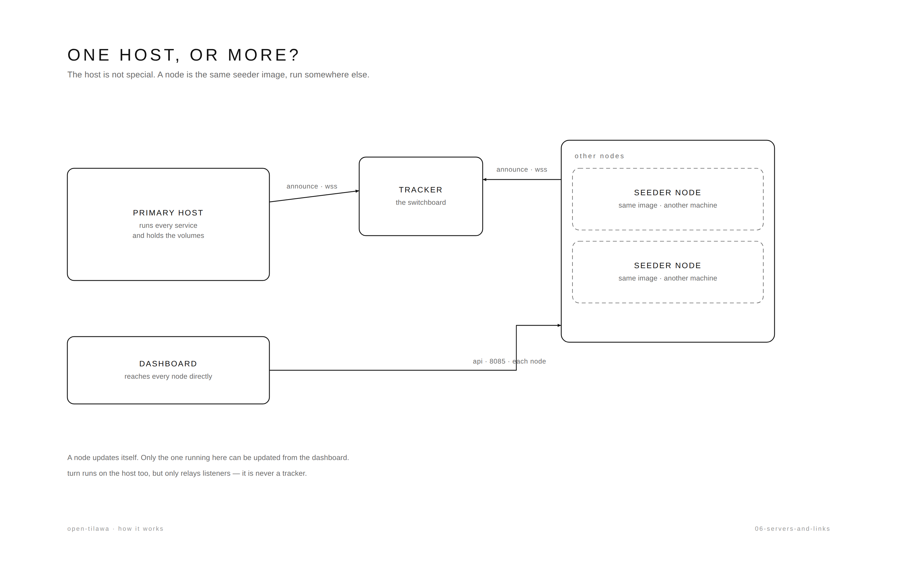
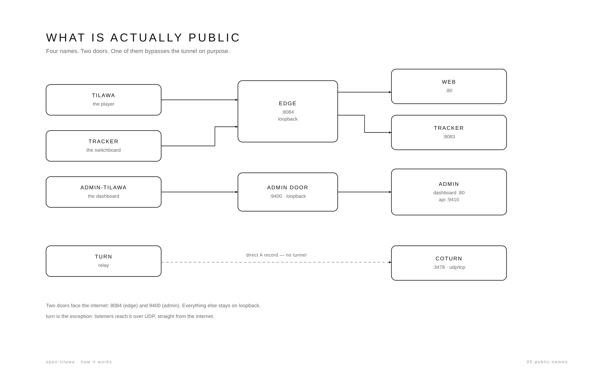

# Infrastructure — how every part fits

One host, one set of containers, five public names. This is the map: what
each piece does, which port it listens on, and how data moves between them.

*The compose project, and the Gun relay beside it. Plain-language version:
[What runs on the box](how-it-works/01-what-runs.md).*

*The host is not special: a seeder node is the same image on another machine.
[One host, or more?](how-it-works/06-servers-and-links.md).*

*Five names, two doors, one exception. Ports stay in the table in §7; the story is
in [What is actually public](how-it-works/05-public-names.md).*

## 1. Public site — `web`

- **Image:** built from `apps/web` (Vite), served by nginx on port 80; only the
  edge publishes it.
- **What it does:** lists the published reciters (read from the admin
  catalogue), plays audio from torrents in the browser (WebTorrent + a service
  worker), and serves the payload of the `/media` web seed — the only HTTP
  fallback. Flow: [STREAMING.md](STREAMING.md).
- **Speeds:** the player reports peers and ↓/↑ rates through one formatter
  (`formatSpeed`), so 900 B/s, 40 KB/s and 1.2 GB/s all read correctly.
- **Content source:** `GET /api/public/reciters` (published rows only). The
  bundle carries no reciter list; the last good payload is cached in
  `localStorage` so a catalogue outage costs freshness, not playback.
- **Volumes:** `seed_torrents` → `/usr/share/nginx/html/torrents`,
  `seed_downloads` → `/usr/share/nginx/html/media` (read-only, `limit_rate 1m`).
- **Preview channel:** `web-staging` is the same image built from the `staging`
  worktree and served at `staging.tilawah.cc` through the same edge. Profile
  `preview` (a plain `up -d` skips it), no published port, the same two read-only
  volumes. It reads the prod catalogue and relay, so it is a UI canary, not a
  data sandbox. `/media` answers any origin — a magnet's web seed is an absolute
  prod URL, so the staging origin fetches it cross-origin.

## 2. Tracker — `tracker`

- **Image:** `bittorrent-tracker --http --ws --port 8083 --stats`.
- **Binding:** `127.0.0.1:8083` on the host, on the compose network as `tracker`.
- **Public name:** `tracker.tilawah.cc`, one name, through a Cloudflare tunnel
  with `enableWebsockets: true`; the edge proxies to the tracker with
  `Upgrade`/`Connection` headers preserved. The old `trackerf` hostname is gone
  (DNS record deleted).
- **State:** none. It is stateless; no volume, no backup, safe to recreate.
- **Stats:** `/stats` is public on the tracker host; it must stay behind the
  proxy rather than published directly.

## 3. Seeder — `seeder`

- **Image:** `ghcr.io/adelpro/open-tilawa-seeder` (multi-arch), built from
  `apps/seeder`. Runs `seed-all.mjs`.
- **What it holds:** the `.torrent` files and the audio in the `/data` volume —
  nothing is baked into the image. Two volumes, not one: `/data/torrents`
  (metadata, rebuildable) and `/data/downloads` (gigabytes, not cheap to
  re-fetch), so recreating the container keeps both.
- **Peer port:** the node binds `TORRENT_PORT` (default 6881) and both compose
  files publish it TCP+UDP. Without that the client asks the OS for a random
  port and only ever dials out, so peers that cannot reach it see one fewer
  seeder for the same content.
- **Admin API:** Basic auth on `:8085`; `/health` is public. The node **refuses
  to start** without a real `ADMIN_PASS` (the compose placeholder counts as
  none).
- **What `/health` answers:** `version`, `sha`, `disk {free,total}`,
  `quotaBytes`, `usedBytes`, `headroomBytes`, `limits`, plus live counters. The
  console stores these on every probe.
- **Disk policy:** `DISK_QUOTA_GB` (or `MAX_DISK_BYTES`) caps what the node will
  hold. Enforcement happens on the node: a magnet's `xl` is checked before
  adding, and the real length is checked the moment metadata arrives — over the
  cap, the torrent is destroyed before payload moves and the API answers 507.
- **Bandwidth:** `UPLOAD_LIMIT_KBPS` / `DOWNLOAD_LIMIT_KBPS` throttle the
  WebTorrent client (0 = unlimited). The admin page shows the cap next to the
  live speed.
- **Admin UI:** `ADMIN_UI=0` keeps `/api` for the console but stops serving the
  browsable page.
- **Announce:** the node announces every torrent it seeds to the tracker list in
  `constants/TRACKERS.js` (canonical: `wss://tracker.tilawah.cc`) in addition to
  the trackers inside each `.torrent`. A remote node without the internal
  `tracker` service simply has one unreachable entry; the rest still announce.
- **Add/remove:** normally driven by the console (it proxies with the stored
  credentials); the node's own API remains the authority.

## 4. TURN — `turn`

- **Image:** `coturn/coturn`, host networking, config at `apps/turn/entrypoint.sh`.
- **Ports:** 3478 UDP/TCP, 5349 TCP (TLS), relay 49160–49200 UDP.
- **Public name:** `turn.tilawah.cc` (TCP via tunnel; UDP reaches the host
  directly).
- **Purpose:** relays WebRTC traffic between browser peers when direct
  connectivity fails. It is **not** a tracker and never appears in a magnet.
- **Monitoring:** the admin probes each registered server with a STUN binding
  request every five minutes and keeps 24 h of latency history.

## 5. Admin — `admin-edge`, `admin-api`, `admin-web`

- **`admin-edge`** (`127.0.0.1:9400`): the only published admin door. `/` → SPA,
  `/api/` → API, `/health` → API health, with HSTS and a 8 MB body limit.
- **`admin-api`**: NestJS. SQLite at `/data/tilawa-admin.sqlite` (volume
  `open-tilawa_admin_data`). Production env (`NODE_ENV=production`), secrets in
  `apps/admin/.env`.
- **`admin-web`**: the console SPA; its nginx template provides the SPA
  fallback (deep links) and the CSP.
- **What it manages:** seeder nodes (status, version, disk/quota/headroom,
  credentials, torrents, software update), TURN servers (status/latency/history),
  the reciter catalogue, the tracker list, and a torrent ↔ magnet tool.
- **Adding a node:** the add form can queue the whole catalogue immediately
  (`POST /reciters/push { nodeIds }`, on by default); the push only ever adds and
  skips what will not fit. The node's own screen shows its reported version and
  build SHA, so "is this the release I published?" needs no shell.
- **Unlinking:** the Remove action is called **Unlink** because that is all it
  does — `DELETE /api/seeders/:id` drops the console row, and the node keeps
  running and seeding. Node-side data is removed per torrent, deliberately.
- **Software updates:** `POST /api/seeders/:id/update` runs a fixed compose pair
  against the host daemon through a mounted socket. It is admin-only,
  CSRF-guarded, audited, and only works for the **local** node. Remote nodes
  update themselves: `docker compose pull && up -d`, or Watchtower with
  `--label-enable` (`WATCHTOWER=1` in `deploy-node.sh`).
- **Roles:** every ops route requires `admin` (satisfied by `super_admin`);
  sessions are cookie-based with CSRF double-submit.

## 6. Data flows

**Catalogue → node**
1. A reciter is added/edited in the console: name, riwaya, infohash, magnet,
   size. The magnet is normalised to the configured tracker list.
2. *Push to nodes* or the per-node checklist adds what the node is missing, by
   magnet, through the node's API.
3. The node resolves metadata, checks its quota, downloads into `/data`, and
   starts seeding. The console reads the node's live inventory — never a copy.

**Magnet → facts**
`POST /api/metadata` on a node resolves a magnet just far enough to report name,
size and file count, then destroys it; the console uses it to fill a reciter
form and to power the converter.

**Torrent → magnet**
The tools screen reads the `.torrent` locally, hashes the exact `info` bytes, and
appends the configured trackers. No node is involved.

**Magnet encoding**
Magnets are stored with literal `:` and `/` (`xt=urn:btih:…`, `tr=wss://…`).
Both are legal inside a query value, and the player's parser (`magnet-uri`) does
not percent-decode: `URLSearchParams.toString()` wrote `xt=urn%3Abtih%3A…`, which
the client rejected as an invalid torrent identifier. `017_unescape_magnets.sql`
repaired the rows; the player also normalises any magnet on the way in, so one
from another source still plays.

## 7. Ports

| Port | Bound to | Service | Public? |
| --- | --- | --- | --- |
| 8084 | 127.0.0.1 | edge (public site + tracker vhost) | via tunnel |
| 8083 | 127.0.0.1 | tracker | via edge |
| 8085 | 127.0.0.1 / node IP | seeder admin API | console only |
| 6881 | node | peer traffic (TCP/UDP) | yes, on nodes |
| 3478, 5349, 49160-49200 | host | TURN | yes (UDP direct) |
| 9400 | 127.0.0.1 | admin edge | via tunnel |
| 9410 / 80 | compose network | admin-api / admin-web | no |

## 8. Environment

Root `.env` (seeder + tracker + turn): `ADMIN_USER`, `ADMIN_PASS`,
`DISK_QUOTA_GB`, `UPLOAD_LIMIT_KBPS`, `DOWNLOAD_LIMIT_KBPS`, `ADMIN_UI`,
`TORRENT_PORT` (inbound peer port, published on the node),
`SEEDER_IMAGE`, `TURN_*`, `TRACKER_PORT`,
`ADMIN_CORS_ORIGIN` (the staging origin must be listed), `STAGING_CONTEXT`
(the `staging` worktree the preview builds from).

`apps/admin/.env` (API): `COOKIE_JWT_SECRET`, `TEMP_JWT_SECRET`,
`TILAWA_PEPPER`, `DB_PATH`, `CORS_ORIGIN`, `EMAIL`, `EMAIL_APP_SPECIFIC_PASS`,
`SEEDER_*` (update action), `DOCKER_GID` (compose).

## 9. Operations

- **Deploy:** `docker compose build <service> && docker compose up -d <service>`.
  Rebuild **every** service whose code changed — a partial deploy is how a stale
  image survives. Versions, tags and branch alignment: [RELEASING.md](RELEASING.md).
- **New node:** run it as root, or it exits before writing anything:
  `curl -fsSL …/deploy-node.sh | sudo bash -s -- --type seeder [--disk GB]
  [--upload-kbps N] [--download-kbps N] [--port N] [--peer-port N] [--admin-ui 0]
  [--watchtower]`. No cap is the default; a cap larger than the free disk is
  refused. The script stops when its admin or peer port is already published,
  and names the container holding it — one node per host. Order of operations is
  written, pulled, started, then `/health` polled for 30 s; a node that never
  answers exits non-zero with its log tail.
- **Node addresses:** prefer the node's Tailscale MagicDNS name
  (`http://node.tailnet.ts.net:8085`) over its IP. The console stores that URL,
  and the tailnet name survives a new DHCP lease or a new ISP address. The admin
  port is reached over the tailnet or the LAN and is never published: it answers
  the admin credentials and can add and delete torrents.
- **Backup:** SQLite backup through the API container's `better-sqlite3`
  (`db.backup()`), stored inside the `admin_data` volume or copied out.
- **Rollback:** restore the backup, then run the previous image tag. Migrations
  are forward-only.
- **Monitoring:** `/health` on the admin and on each seeder; the TURN probe
  history; `docker logs` for the API and cloudflared.

## 10. Known gaps

- Community-node enrollment (outbound token + heartbeat) is designed but not
  built; a community node today needs its admin port reachable.
- `/media` serves the seeder in the same compose stack (the primary node), not
  the whole fleet: a published reciter absent from that node has no HTTP
  fallback. Per-node web seeds or an infohash proxy are the upgrade path.
- Remote nodes update themselves; the console's update button is local only.
- Catalogue manifests are not signed yet.
