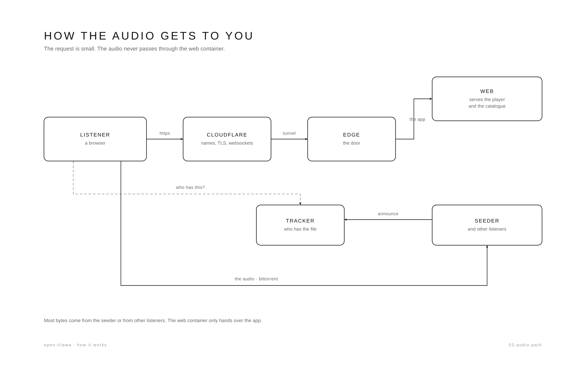

# Playback: from a catalogue row to sound

One page, one `<audio>`, one WebTorrent client, one service worker. The reciter
list is remote, the audio is a torrent, and the only fallback is a web seed on
our own origin.



*The request is small; the audio is not. [The full page](how-it-works/02-audio-path.md).*

```
admin catalogue ──► GET /api/public/reciters (published rows, id, magnet, riwaya)
        │
        ▼
use-reciters ──► toReciters ──► footer ➜ reciter sheet
        │
        ▼  selected reciter (magnet)
use-torrent ──► GET /torrents/<infohash>.torrent ──► client.add(blob)
        │                                          (metadata without peers)
        ▼  torrent.ready → mp3 files → { surahId, file }
use-torrent ──► 8 s with 0 peers ──► torrent.addWebSeed("https://host/media/")
        │
        ▼  selected surah
<audio src="/webtorrent/<infohash>/<path>">
        │
        ▼
service worker ──► Range → torrent pieces ──► 206
        ▲
        └── pieces come from peers, from /media, or both
```

## 1. Which reciters exist

`use-reciters.ts` asks the catalogue for `GET /api/public/reciters` and maps the
answer with `toReciters`:

- only **published** rows are returned by the API;
- `name` is `nameAr`, else a cleaned torrent name;
- `riwaya` is whatever the row says (`Hafs`, `Warsh`, `Qalon`, `unknown`);
- `complet` is `fileCount >= 114`;
- a row without a magnet, without a numeric id, or with an infohash already seen
  is dropped.

The payload is cached in `localStorage` (`tilawa.reciters.v1`). If the catalogue
cannot be reached, the cached list is used; if there is no cache, the player says
it cannot load the reciters instead of inventing a roster. There is no built-in
reciter list.

## 2. Opening the torrent

`use-torrent.ts` keys every torrent by infohash through `torrent-session.ts`, so
three components asking for the same reciter share one add.

1. `GET /torrents/<infohash>.torrent` — served by nginx from the seeder's
   `seed_torrents` volume. This is why metadata arrives with **zero peers**.
2. `client.add(blob, { announce, deselect: true })`.
3. `torrent.ready` → only `.mp3` files, surah number parsed from the name
   (`001.mp3`, `ar_001_Name.mp3`, `ar_Name_001.mp3`), sorted.
4. If the `.torrent` file is missing and no peer answers within 10 s, the player
   shows the existing metadata timeout with a retry.

## 3. Playing a surah

- Selecting a surah calls `file.select()` on that one file. The rest of the
  release (114 files, ~1.2 GB) is deselected, so it does not compete.
- `<audio src>` is set to `file.streamURL`, which is `/webtorrent/<infohash>/<path>`
  — **same origin**. It is never set to a remote media URL.
- The service worker answers each request by translating `Range` into torrent
  reads and replying `206 Partial Content`. Seeking is a new range: WebTorrent
  fetches only the missing pieces, so a seek works long before the whole surah is
  on disk.
- Because the stream is same-origin, `createMediaElementSource` can feed the
  analyser, and the spectrum is real.

## 4. Cold start: no peers

Peers are the fast path, not the requirement.

1. When the torrent is ready, a timer starts.
2. If `numPeers === 0` for **8 continuous seconds** and the release is not
   complete, the client calls
   `torrent.addWebSeed(new URL('/media/', location.origin).href)` **once**.
3. From then on the torrent has two sources. WebTorrent requests pieces from the
   peers and the web seed concurrently; a piece from either is verified against
   the torrent's hashes before it is used.
4. Nothing about the player changes: `src` is still the service-worker URL, so
   there is no reload, no seek, no re-buffer. Pieces delivered by the web seed are
   stored and **uploaded to other peers** like any other piece.
5. If a peer appears later, it is used immediately — there is no mode switch,
   because the web seed never replaced anything.

If the file behind `/media` is missing, that request 404s, WebTorrent marks the
piece missing and retries; the stream sheet reports the surah's fallback as
unavailable instead of pretending.

### Why the HTTP channel is never closed

The web seed is not a startup crutch that gets discarded once a peer says hello:
**it stays attached for the life of the torrent**, and that is a deliberate
choice, not an oversight.

Mobile P2P is bursty. A phone hands over between Wi-Fi and 4G, a NAT binding
expires, a tab is backgrounded and its WebRTC connection goes quiet, a peer
closes the lid. If the fallback were detached at the first connected peer, every
one of those ordinary moments would turn back into a stall — the listener would
hear the drop at exactly the point the app had just proved it could avoid it.

Keeping it costs nothing while the swarm is healthy:

- WebTorrent asks **both** sources for each block and takes whichever answers
  first, so a healthy peer simply wins the race; the web seed sits idle.
- The fallback is rate-limited to 1 MB/s per connection (nginx `limit_rate`), so
  it can never outrun a working peer or saturate the line.
- Anything the fallback *does* deliver is verified, stored and **uploaded to other
  peers**, so a listener on a weak connection becomes a seeder for the next one.

That is why the sheet reports **`P2P + HTTP`** rather than picking a winner: both
channels are open, and the honest number is the peer count plus the fact that the
safety net is still there.

## 5. Why the web seed is our origin

A web seed is a `fetch()` made by JavaScript. That rules out two tempting
alternatives:

- **Another host without CORS** — the request is blocked before a byte arrives.
  Itqan's audio host sends no `Access-Control-Allow-Origin`.
- **A flat file host** — WebTorrent asks for `<base>/<torrent folder>/<file>`.
  A host serving `<base>/001.mp3` cannot answer that, whatever its CORS headers.

`/media/` is same-origin (no CORS), and the seeder's downloads volume already has
the layout `<torrent folder>/<file>`, so nginx can serve it verbatim:

```
https://tilawa.quran.us.kg/media/            ← web seed base
https://tilawa.quran.us.kg/media/Quran-MP3-Ghamdi/002.mp3
```

`docker-compose.yml` mounts `seed_downloads` read-only into the web container at
`/usr/share/nginx/html/media`; `apps/web/nginx.conf` serves it with
`try_files $uri =404` and `limit_rate 1m`.

**Limitation:** `/media` reflects the seeder in the same compose stack (the
primary node), not the whole fleet. A reciter published but absent from that node
has no fallback. Routing per node or proxying by infohash is described in the
2026-10-27 design document.

## 6. Desktop (≥ 1024 px) — the quiet stage

The phone's bottom sheets and sandwich menu are replaced, not enlarged:

- **No bottom sheet, no hamburger.** The lists open as a 360 px panel docked to
  the reading edge, below the header. It is not modal: no backdrop, no focus
  trap, the player stays visible and keeps playing. `Esc`, the close button or
  picking a row closes it. While it is open the stage re-centres in the
  remaining width (it never slides under the panel). Below 1024 px the platform
  dialog is still used.
- **The title and the reciter line are the triggers.** The surah name opens the
  surah list, the reciter name opens the reciter list; a `▾` appears on hover and
  on keyboard focus.
- **Navigation is four words** in the header (القرّاء · السور · عن تلاوة ·
  الخصوصية) instead of a menu button.
- **The stage:** surah name at 22 vh, controls in the lower third, a 160 px
  spectrum horizon at the bottom at 70 % ink, and a 1 px floor line that stays
  when paused so the page never becomes a blank sheet.
- The footer keeps only mute, speed and the stream ring, sitting above the
  horizon; the name rows are hidden because the stage already shows them.

## 7. What the interface reports

| Place | What it shows |
|---|---|
| Footer icon | `wifi` = peers or waiting, `link` = the web seed is in use |
| Footer ring | progress of **the current file**, not the whole release |
| Footer rows | surah name, reciter name, mute, speed chip when ≠ 1× |
| Stream sheet | source (الأقران / الخادم / بانتظار), peers, ↓/↑, downloaded, progress, files, and the fallback state for this surah (one cached `HEAD`) |
| Reciter sheet | name, «كامل/جزئي», riwaya chip; search and riwaya filters |

The sheet's «البديل» row is the only extra network call: one `HEAD` per surah the
listener opens, cached for the session.

## 8. Failure modes

| Situation | What happens |
|---|---|
| Catalogue unreachable | cached roster, else «تعذّر تحميل القرّاء» + retry |
| Catalogue returns nothing published | «لا يوجد قرّاء منشورون بعد.» + retry |
| No `.torrent` and no peers | 10 s metadata timeout + retry |
| Service worker unavailable (no HTTPS) | "Streaming is unavailable…" error |
| Peers exist but cannot connect (NAT) | after 8 s the web seed carries playback |
| `/media` file missing | web seed retries; the sheet says the fallback is unavailable |
| Paused | the spectrum is hidden entirely; the canvas keeps its height so nothing jumps |

## 9. What is deliberately absent

- No `MediaSource`/HLS: each surah is one MP3, streamed with ranges.
- No `<audio src>` pointing at a remote host: that path cannot seed, cannot return
  to peers, and silences the analyser.
- No per-reciter HTTP sources, no fallback playlist, no source badge.
- No whole-file buffering: `file.blob()` would download a 240 MB surah before
  playing.
