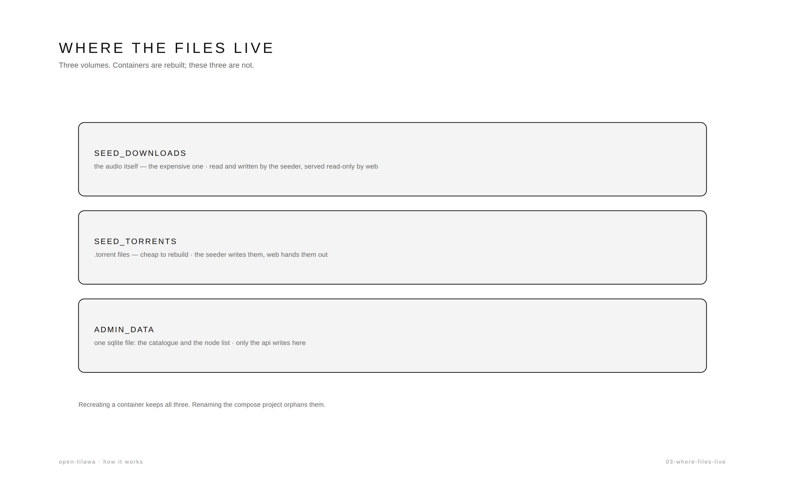

# Where the files live

Three volumes, three different costs.

| Volume | What is in it | If you lose it |
|---|---|---|
| `seed_downloads` | the audio itself | re-download the corpus — the expensive one |
| `seed_torrents` | the `.torrent` files | rebuild them from the audio |
| `admin_data` | one SQLite file: catalogue, nodes, TURN servers | rebuild by hand |

Containers are disposable; these are not. Recreating a container keeps all three,
which is why `docker compose up -d --build` is safe for data.

Renaming the compose project orphans them, because the project name is part of the
volume name. That is why `name: open-tilawa` is pinned in `docker-compose.yml`.

Details: [INFRASTRUCTURE.md](../INFRASTRUCTURE.md) §1, §3, §5.
