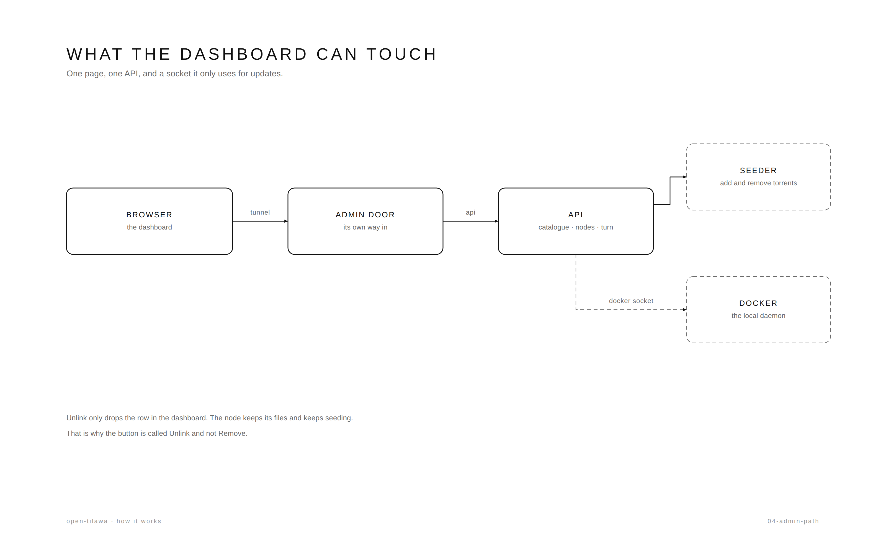

# What the console can touch

One page, one API, two things behind it.

- **the nodes** — the API talks to each seeder's admin port with stored
  credentials: add a torrent, drop a torrent, read health, disk and quota.
- **the local docker daemon** — mounted as a socket, used for one thing only:
  updating the node that runs on this host. It is admin-only, CSRF-guarded and
  audited.

The console is not a remote shell. Everything it does goes through the node's own
API, which stays the authority — the console reads live inventory, it never keeps
a copy.

**Unlink** is called that because it is all it does: the row disappears here, the
node keeps its files and keeps seeding. Removing data is a separate, per-torrent
action on the node.

Details: [INFRASTRUCTURE.md](../INFRASTRUCTURE.md) §5.
